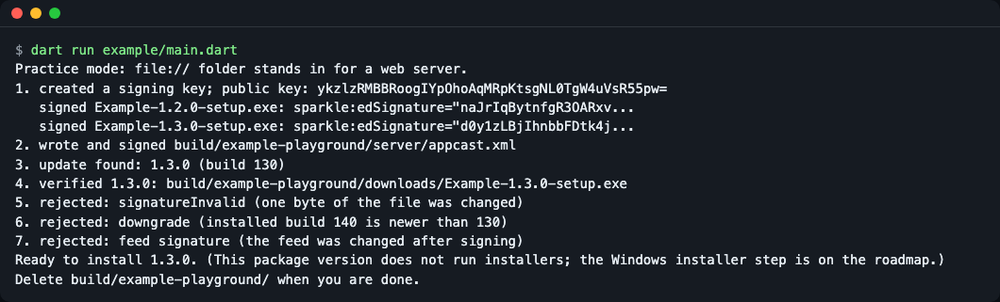
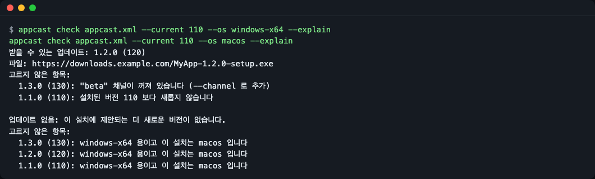
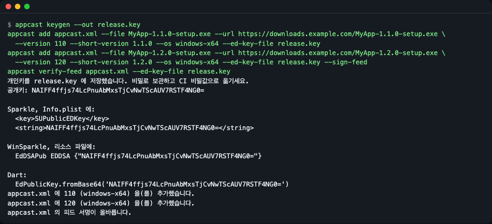
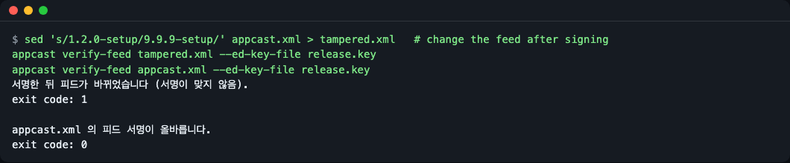
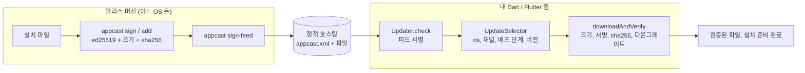

# appcast_updater

[English](README.md) | **한국어**

## 소개

순수 Dart 로 Sparkle 호환 appcast 읽기, Ed25519 서명, 업데이트 검증을 해 주는 패키지이고, Linux·Windows·macOS 어디서나 릴리스에 서명하고 피드를 편집하는 `appcast` 명령줄 도구도 함께 있습니다. [Sparkle](https://sparkle-project.org/) 과 같은 피드 형식·같은 키를 쓰므로, 이미 Sparkle 로 macOS 앱을 배포하는 Flutter 데스크톱 앱이 같은 피드로 Windows 업데이트도 확인하고 검증할 수 있습니다. 0.1.0 은 업데이트를 확인하고, 고르고, 검증하는 데까지입니다. 설치는 아직 하지 않습니다([로드맵](#로드맵)과 [알려진 한계](#알려진-한계) 참고).



*`dart run example/main.dart` 는 전 과정을 오프라인으로 돌립니다. 진짜 키, 진짜 서명, 그리고 거절되는 공격 세 가지.*

## 왜 필요한가

Sparkle 의 `sign_update`·`generate_appcast` 도구는 macOS 바이너리라서, Linux·Windows CI 에서 릴리스에 서명하려면 다른 방법이 필요합니다. 또 이미 Sparkle 피드와 키가 있는 앱이 자체 형식을 쓰는 패키지로 바꾸면 둘 다 갈아엎어야 합니다. 이 패키지는 appcast 와 키는 그대로 두고, 서명과 검증을 어디서나 도는 Dart 코드로 옮깁니다.

다른 Dart·Flutter 선택지와의 비교입니다(2026-11-12 에 각 프로젝트 페이지와 이슈에서 읽은 내용이며, 프로젝트는 바뀌므로 정하기 전에 해당 페이지를 확인하세요).

| | 피드 형식 | Sparkle 과 같은 키 | Linux CI 에서 서명 | Dart 에서 부르는 업데이트 검증 |
|---|---|---|---|---|
| [auto_updater](https://pub.dev/packages/auto_updater) 1.0.0 | Sparkle appcast (macOS 는 Sparkle, Windows 는 WinSparkle 을 감쌈) | 예 | `sign_update` 가 macOS 전용 | 아니요, 네이티브 라이브러리가 함 |
| [desktop_updater](https://pub.dev/packages/desktop_updater) 3.2.11 | 자체 JSON 매니페스트 | 아니요 | 자체 CLI | 자체 체인 |
| [upgrader](https://pub.dev/packages/upgrader) 13.8.0 | 스토어 안내용으로 appcast 를 읽음 | 해당 없음 | 해당 없음 | 아니요, `edSignature` 필드를 읽기만 함 |
| **appcast_updater** 0.1.0 | Sparkle appcast | 예(확인함, [호환성](#호환성) 참고) | 예, `appcast` CLI | 예, `Updater` / `UpdateVerifier` |

잘 맞는 경우: Sparkle 로 macOS 앱을 배포하고(또는 배포할 계획이고) Windows 에도 같은 피드·같은 키를 쓰고 싶을 때, Linux·Windows 러너에서 릴리스에 서명하고 싶을 때, 업데이트 확인을 읽고 테스트할 수 있는 순수 Dart 코드로 두고 싶을 때.

다른 도구가 나은 경우: 지금 바로 쓸 수 있는 업데이트 창과 설치 처리가 필요하면 [auto_updater](https://pub.dev/packages/auto_updater), 자체 릴리스 CLI 를 갖춘 올인원 Flutter 패키지가 필요하면 [desktop_updater](https://pub.dev/packages/desktop_updater), 스토어 페이지로 안내만 하면 되면 [upgrader](https://pub.dev/packages/upgrader).

## 설치

[Dart SDK](https://dart.dev/get-dart) 3.5 이상(Flutter SDK 에 포함)과 `git` 이 필요합니다. 아직 pub.dev 에는 없으니 git 의존성으로 설치합니다. 이 문서는 Dart 3.8.1 로 확인했습니다.

앱의 `pubspec.yaml` 에 있는 `dependencies:` 아래에 패키지를 추가합니다(새 빈 폴더에서 시작한다면 [빠르게 시작하기](#빠르게-시작하기)에 완성된 `pubspec.yaml` 이 있습니다).

```yaml
# 앱의 pubspec.yaml
dependencies:
  appcast_updater:
    git: https://github.com/LeeGyeongPil/appcast-updater
```

```bash
dart pub get
```

`appcast` 명령줄 도구만 쓰려면:

```bash
dart pub global activate --source git https://github.com/LeeGyeongPil/appcast-updater
appcast --version
```

```text
appcast 0.1.0
```

셸이 `appcast` 명령을 찾지 못한다고 하면 pub 캐시의 `bin` 폴더가 아직 `PATH` 에 없는 것입니다(`activate` 가 `Pub installs executables into ..., which is not on your path` 라고 경고합니다). `$HOME/.pub-cache/bin` 을 `PATH` 에 추가하고(Windows: `%LOCALAPPDATA%\Pub\Cache\bin`) 터미널을 새로 열거나, `appcast` 대신 `dart pub global run appcast_updater:appcast` 로 실행하세요.

런타임 의존성: `xml`, `cryptography`, `crypto` (모두 순수 Dart, 네이티브 코드 없음).

## 빠르게 시작하기

릴리스 두 개가 든 서명된 피드를 만들고, "1.1.0" 을 쓰는 설치가 그 피드를 확인하게 해 봅니다. [설치](#설치)에서 받은 `appcast` 명령이 필요합니다. 새 빈 폴더에서 시작해 모든 단계를 그 안에서 실행하세요(`MyApp-*.exe` 는 실제 설치 파일을 대신하는 가짜 파일입니다).

```bash
mkdir appcast-quickstart
cd appcast-quickstart
mkdir feed
head -c 4000 /dev/zero | tr '\0' 'a' > feed/MyApp-1.1.0-setup.exe
head -c 5000 /dev/zero | tr '\0' 'b' > feed/MyApp-1.2.0-setup.exe
appcast keygen --out release.key
```

```text
개인키를 release.key 에 저장했습니다. 비밀로 보관하고 CI 비밀값으로 옮기세요.
공개키: <base64 ed25519 공개키>
...
```

(공개키는 실행할 때마다 다릅니다. 이 명령은 `Info.plist`, WinSparkle 리소스 파일, Dart 코드에 붙여 넣을 줄도 함께 출력합니다. 이 문서의 `appcast` 출력은 한국어 화면입니다. 시스템 언어가 한국어(`LANG=ko_KR.UTF-8` 등)이면 저절로 한국어로 나오고, 그렇지 않으면 영어로 나옵니다. 언제나 한국어로 보려면 `--lang ko` 를 붙이세요. [언어](#언어) 참고.)

```bash
appcast add feed/appcast.xml --file feed/MyApp-1.1.0-setup.exe --url file://$PWD/feed/MyApp-1.1.0-setup.exe \
  --version 110 --short-version 1.1.0 --os windows-x64 --ed-key-file release.key
appcast add feed/appcast.xml --file feed/MyApp-1.2.0-setup.exe --url file://$PWD/feed/MyApp-1.2.0-setup.exe \
  --version 120 --short-version 1.2.0 --os windows-x64 --ed-key-file release.key --sign-feed
```

```text
feed/appcast.xml 에 110 (windows-x64) 을(를) 추가했습니다.
feed/appcast.xml 에 120 (windows-x64) 을(를) 추가했습니다.
```

이제 앱 쪽입니다. Dart 프로그램은 `pubspec.yaml` 을 통해 `package:appcast_updater` 를 찾으므로, 같은 폴더에 하나 만들고 의존성을 받습니다(이 단계는 GitHub 와 pub.dev 에 접속합니다).

```bash
cat > pubspec.yaml <<'EOF'
name: check_feed
publish_to: none

environment:
  sdk: ^3.5.0

dependencies:
  appcast_updater:
    git: https://github.com/LeeGyeongPil/appcast-updater
EOF
dart pub get
```

```text
Resolving dependencies...
...
Got dependencies!
```

첫 실행에서는 마지막 줄이 `Changed N dependencies!` 로 나올 수도 있습니다. 둘 다 정상입니다.

아래를 같은 폴더에 `check.dart` 로 저장합니다(공개키는 첫 인자로 받습니다). 이 프로그램이 출력하는 문장은 직접 쓴 코드의 영어 문장입니다.

```dart
import 'dart:io';

import 'package:appcast_updater/appcast_updater.dart';

Future<void> main(List<String> args) async {
  final updater = Updater(
    feedUrl: Uri.file(File('feed/appcast.xml').absolute.path),
    publicKey: EdPublicKey.fromBase64(args.first),
    currentVersion: '110', // sparkle:version of the installed app
    os: 'windows-x64',
    requireSignedFeed: true,
  );

  final found = await updater.check();
  final item = found.item;
  if (item == null) {
    print('Up to date.');
    return;
  }
  print('Offered: ${item.shortVersion} (build ${item.version})');

  try {
    final file = await updater.downloadAndVerify(item,
        into: Directory('downloads'));
    print('Verified: ${file.path}');
  } on UpdateVerificationException catch (e) {
    print('Rejected: ${e.reason.name}');
  }
}
```

```bash
dart run check.dart "$(appcast pubkey --ed-key-file release.key)"
```

```text
Offered: 1.2.0 (build 120)
Verified: downloads/MyApp-1.2.0-setup.exe
```

이제 공격자나 깨진 다운로드처럼 `feed/MyApp-1.2.0-setup.exe` 의 한 바이트를 바꾸고 다시 실행합니다.

```bash
printf 'X' | dd of=feed/MyApp-1.2.0-setup.exe bs=1 count=1 conv=notrunc 2>/dev/null
dart run check.dart "$(appcast pubkey --ed-key-file release.key)"
```

```text
Offered: 1.2.0 (build 120)
Rejected: signatureInvalid
```

크기는 그대로지만 서명이 더는 맞지 않습니다. 바뀐 파일은 저장되지 않아서 `downloads/` 에는 첫 실행에서 검증된 파일만 남아 있습니다. 실제 릴리스에서는 `--url` 에 직접 운영하는 정적 호스팅의 `https://` 주소를 씁니다. `file://` 은 연습용입니다.

## 릴리스 쪽: CLI

모든 명령은 `--lang en|ko` 를 받습니다([언어](#언어) 참고). 종료 코드: `0` 성공, `1` 검증 실패 또는 파일 문제, `2` 사용법 오류, `3` 키 문제.

| 명령 | 하는 일 |
|---|---|
| `appcast keygen --out <file>` | Ed25519 키 생성(32바이트 시드, base64, Sparkle 2 형식). 기존 파일은 덮어쓰지 않습니다. |
| `appcast pubkey --ed-key-file <file\|->` | 공개키(`SUPublicEDKey` 값) 출력. |
| `appcast sign <file> --ed-key-file <file\|-> [-p]` | `sparkle:edSignature="..." length="..."` 출력(Sparkle `sign_update` 와 같은 문장). `-p` 는 서명만 출력. |
| `appcast verify <file> <signature> --public-key <b64> \| --ed-key-file <file\|->` | 서명이 파일과 맞으면 종료 코드 0. |
| `appcast add <appcast.xml> --file ... --url ... --version ...` | 릴리스에 서명하고 피드 맨 위에 항목 추가(피드가 없으면 생성). 옵션: `--short-version`, `--os`, `--channel`, `--min-system`, `--max-system`, `--phased-interval`, `--critical`, `--critical-below`, `--notes-url`, `--installer-arguments`, `--pub-date`, `--replace`, `--sign-feed`. |
| `appcast sign-feed <appcast.xml> --ed-key-file <file\|->` | 피드 서명을 붙이거나 교체. |
| `appcast verify-feed <appcast.xml\|url> --public-key <b64> \| --ed-key-file <file\|->` | 피드 서명이 올바르면 종료 코드 0. `--ed-key-file` 을 쓰면 개인키에서 공개키를 꺼냅니다. |
| `appcast check <appcast.xml\|url> --current <v> --os <name> --explain` | 이 설치가 받을 업데이트와, 나머지 항목이 고르지 않은 이유 출력. |

키를 표준 입력으로 읽으려면 `--ed-key-file -` 를 씁니다. CI 비밀값에 알맞습니다: `echo "$RELEASE_KEY" | appcast sign app.exe --ed-key-file -`.

`check --explain` 은 "왜 내 앱에 업데이트가 안 보이지?" 에 답합니다.



*1.3.0 은 `beta` 채널이라 고르지 않았습니다. macOS 설치에는 모든 항목이 `windows-x64` 용이라 맞는 게 없습니다.*

`--explain` 을 붙이면 건너뛸 수밖에 없던 항목이 무엇이 잘못됐는지도 알려 주므로, 피드의 어디를 고칠지 알 수 있습니다(`--explain` 이 없으면 첫 줄만 나옵니다).

```text
업데이트 없음: 이 설치에 제안되는 더 새로운 버전이 없습니다.
항목 1번을 건너뛰었습니다: url 속성이 있는 <enclosure> 가 없습니다.
```

릴리스 흐름을 한 화면에(CI 작업이 실제로 이 줄들을 실행합니다):



*`add` 두 번으로 피드를 만들고, `--sign-feed` 로 서명하고, `verify-feed` 로 확인합니다.*

서명한 뒤 피드를 고치면 검증이 종료 코드 1 로 실패합니다.



*고친 사본은 거절되고, 그대로인 피드는 계속 통과합니다.*

## 앱 쪽: Dart API

모두 `package:appcast_updater/appcast_updater.dart` 에서 내보냅니다.

| 이름 | 하는 일 | 주요 인자 | 반환·예외 |
|---|---|---|---|
| `Updater` | 파사드: 피드 확인 후 내려받기·검증. | `feedUrl`, `publicKey`, `currentVersion`, `os`, `channels`, `systemVersion`, `rolloutGroup`, `requireSignedFeed`, `fetcher` | `check()` 는 `UpdateCheck`(`item`, `critical`, `selection`, `feedWasSigned`), `downloadAndVerify(item, into:)` 는 검증된 `File` |
| `UpdateSelector` | 설치에 맞는 항목을 고르고 탈락 이유를 기록. | `Updater` 와 같은 필터 | `select(appcast)` 는 `Selection`(`item`, `critical`, `rejections`) |
| `RejectReason`, `Rejection` | 고르지 않은 이유: `wrongOs`, `channelNotAllowed`, `systemTooOld`, `systemTooNew`, `informational`, `notNewer`, `rolloutNotYet`, `superseded`. | | |
| `RolloutGroup`, `RolloutGroupStore` | 단계적 배포 7그룹 중 하나를 한 번 뽑아 파일에 고정. | `File` | `loadOrCreate()` 는 그룹(0-6) |
| `UpdateVerifier` | 내려받은 파일 검증: 크기, 서명, sha256, 다운그레이드. | `publicKey`, `allowUnsigned` | `verifyFile(file, item, currentVersion:)`, 실패 시 `UpdateVerificationException`(`reason` 은 `VerifyFailure`) |
| `SignedFeed` | 피드 서명 붙이기·검증·떼기. | 원본 바이트, 키 | `sign`, `verify`(본문 반환), `strip`, `hasSignature`, 실패 시 `FeedSignatureException`(`FeedFailure`) |
| `Appcast`, `AppcastItem`, `Enclosure`, `ItemError` | 피드 파싱. 형식이 잘못된 항목은 피드 전체를 실패시키지 않고 목록으로 보고. | XML 문자열 또는 바이트 | `Appcast.parse`, `Appcast.parseBytes`, 실패 시 `AppcastFormatException` |
| `AppcastWriter` | 피드 생성·항목 추가(기존 네임스페이스 접두를 유지). | | `createEmpty`, `parse`, `addItem`, `toXmlString`, 중복 시 `DuplicateItemException` |
| `EdKeyPair`, `EdPrivateKey`, `EdPublicKey` | 키. 옛 96바이트 키를 포함해 Sparkle 키 파일을 읽음(공개키 추출·검증만). | 시드 또는 키 파일 내용 | 실패 시 `KeyFormatException` |
| `signBytes`, `signFile`, `verifyBytes`, `SparkleSignature` | 바이트·파일에 대한 Ed25519. `toSparkleAttributes()` 는 `sign_update` 줄 출력. | 데이터, 키 | base64 서명 / `SparkleSignature` / `bool` |
| `compareVersions` | Sparkle `SUStandardVersionComparator` 규칙의 버전 비교. | 문자열 둘 | 음수·`0`·양수 `int` |
| `Fetcher`, `FileFetcher`, `HttpFetcher` | 크기 상한을 두고 바이트·파일 가져오기. `https://`·`file://` 만, `http://` 는 `allowInsecureHttp` 필요. | `Uri`, `maxBytes` | 실패 시 `DownloadException` |

앱에서는 `requireSignedFeed: true` 를 켜세요. 끄면 서명 주석이 없는 피드도 받아들입니다(서명 주석이 있는 피드는 항상 검증합니다).

**예 1. 이 설치에 왜 업데이트가 안 보이나?** `UpdateSelector` 를 직접 쓰고 이유를 출력합니다.

```dart
final selection = UpdateSelector(
  currentVersion: '110',
  os: 'windows-x64',
).select(Appcast.parse(File('feed/appcast.xml').readAsStringSync()));
for (final r in selection.rejections) {
  print('${r.item.version}: ${r.reason.name}');
}
```

**예 2. Dart 에서 릴리스 파일에 서명하기**(Sparkle `sign_update` 와 같은 문장):

```dart
final keys = await EdKeyPair.generate();
final sig = await signFile(File('feed/MyApp-1.2.0-setup.exe'), keys.privateKey);
print(sig.toSparkleAttributes()); // sparkle:edSignature="..." length="5000"
```

**예 3. 연습 실행.** [`example/main.dart`](example/main.dart) 는 `build/example-playground/` 안에서 전부 오프라인으로 돌며 반복 실행해도 안전합니다.

```bash
dart run example/main.dart
```

```text
5. rejected: signatureInvalid (one byte of the file was changed)
6. rejected: downgrade (installed build 140 is newer than 130)
7. rejected: feed signature (the feed was changed after signing)
```

연습용 목(mock) 모드입니다. "내려받기 서버"는 `file://` 로 읽는 폴더이고 설치 파일은 실행하지 않습니다. 키·서명·해시와 모든 거절은 실제 계산입니다. 예제 출력은 영어로만 나옵니다.

## 검증이 동작하는 방식

봉인 스티커가 붙은 택배를 떠올리세요. 봉인 기계(개인키)는 나만 갖고 있고, 고객은 모두 봉인 무늬의 사본(공개키)을 갖고 있습니다. 봉인이 맞지 않는 택배는 열지 않습니다.

- **appcast**: 업데이트 피드입니다. 릴리스마다 `<item>` 이 하나씩 있는 RSS 파일이고, `<enclosure>` 에 내려받을 주소·크기·서명이 들어 있습니다. Sparkle 이 쓰는 형식입니다.
- **EdDSA(Ed25519) 서명**: 릴리스 파일의 바이트 전체에 거는 64바이트 서명입니다. 앱에는 32바이트 공개키(Sparkle 의 `SUPublicEDKey`)만 넣습니다. 개인키가 없는 사람은 앱이 받아들일 업데이트를 만들 수 없습니다.
- **서명된 피드**: Sparkle 2.9 이상은 피드 자체에도 서명할 수 있습니다(`SURequireSignedFeed`). 끝의 `<!-- sparkle-signatures: ... -->` 주석에, 그 앞 원본 바이트에 대한 서명이 들어 있습니다. 서명 대상이 바이트이므로 검증은 내려받은 바이트에 대해, 피드를 파싱하거나 다시 쓰기 전에 합니다. XML 을 다시 직렬화하면 바이트가 달라져 서명이 깨집니다. 피드를 다른 것으로 바꿔치기하는 공격을 막습니다. 피드를 한 번이라도 고치면 서명이 사라지므로 마지막 수정 뒤에 다시 서명하세요.
- **다운그레이드 차단**: 서명이 맞아도 설치된 것보다 낮은 버전이면 거절합니다. 공격자가 옛 취약 버전을 다시 내려주는 것을 막습니다.
- **업데이트 서명은 코드 서명이 아닙니다.** EdDSA 서명은 파일이 나에게서 왔다는 것을 증명합니다. 설치 프로그램을 실행할 때 운영체제가 확인하는 Windows 코드 서명이나 macOS 코드 서명·공증을 대신하지 않습니다. 둘 다 필요합니다.



1. 릴리스 머신이 설치 파일마다 서명하고 피드에 항목을 추가한 뒤, 피드에 서명합니다.
2. 앱은 피드를 내려받아 피드 서명부터 확인합니다.
3. 이 설치에 맞는 가장 새 항목을 고릅니다([선택 규칙](#선택-규칙) 참고).
4. 크기 상한을 두고 파일을 내려받고, 다른 무엇이 건드리기 전에 검증합니다.

내려받은 파일의 검사 순서: 크기(내용을 읽기 전), Ed25519 서명, `au:sha256`, 다운그레이드. 그 밖의 안전 규칙: `https://` 만 허용(평문 `http://` 는 `allowInsecureHttp` 필요), 리다이렉트도 한 단계씩 검사, 검사를 통과한 뒤에야 최종 파일 이름을 얻음, `https://` 로 받은 피드는 앱이 로컬 `file://` 경로를 읽게 만들 수 없음.

## 선택 규칙

`UpdateSelector`(`Updater.check()` 와 `appcast check` 가 사용)는 모든 항목에 아래 규칙을 적용하고, 고르지 않은 항목마다 이유를 기록합니다. 규칙은 Sparkle 의 [게시 문서](https://sparkle-project.org/documentation/publishing/)(2026-11-12 확인)를 따릅니다.

| 규칙 | 동작 |
|---|---|
| 운영체제 | `sparkle:os` 가 있는 항목은 설치의 `os` 와 맞아야 합니다(`windows` 로 표시한 항목은 `windows-x64` 설치에도 맞음). `sparkle:os` 가 없는 항목은 모든 OS 에 맞습니다(WinSparkle 동작). Sparkle 처럼 macOS 로 읽으려면 `untaggedMeans: 'macos'` 를 씁니다. |
| 채널 | `sparkle:channel` 이 없는 항목은 항상 포함됩니다. 채널이 있는 항목은 설치가 그 채널을 켠 경우에만 고릅니다. |
| 시스템 버전 | `systemVersion` 을 줄 때만 검사합니다. `minimumSystemVersion` 보다 낮거나 `maximumSystemVersion` 보다 높으면 거절합니다. |
| 더 새것만 | 항목의 `sparkle:version` 이 `currentVersion` 보다 커야 합니다. 비교는 Sparkle 규칙(`1.10` > `1.9`, `1.0beta` < `1.0`)을 따릅니다. 남은 항목 중 가장 높은 버전을 고릅니다. |
| 중요 업데이트 | `sparkle:version` 값이 있는 `criticalUpdate` 는 설치 버전이 그 값보다 **낮을 때만** 중요합니다. 값이 없으면 모두에게 중요합니다. 중요 업데이트는 단계적 배포를 기다리지 않습니다. |
| 단계적 배포 | `phasedRolloutInterval`, `pubDate`, 그리고 updater 에 지정한 그룹이 필요합니다. 설치마다 7개 그룹(0~6) 중 하나에 속하고, `pubDate + 그룹 x 간격` 부터 그 항목이 보입니다. 중요 업데이트와 사용자가 직접 확인한 경우(`userInitiated: true`)는 이 대기를 건너뜁니다. 한 설치의 그룹이 바뀌지 않도록 `RolloutGroupStore` 로 저장하세요. |
| 안내용 항목 | informational 로 표시된 항목은 파싱하지만 내려받기 대상으로 내놓지 않습니다. |

## 호환성

실제 Sparkle 2.10.1(릴리스 압축 파일)로 확인한 범위입니다. 벡터는 `test/vectors/`, 만든 과정은 `test/vectors/README.md`, 확인 2026-11-12.

- `appcast sign` 은 같은 키·같은 파일에 대해 Sparkle `sign_update` 와 같은 `sparkle:edSignature="..." length="..."` 문장을 출력합니다(`test/sparkle_compat_test.dart` 의 문자열 비교).
- `sign_update` 가 만든 서명을 Dart 가 검증하고, Ed25519 구현은 [RFC 8032](https://www.rfc-editor.org/rfc/rfc8032) 시험 벡터를 통과합니다.
- Sparkle `sign_update --verify` 가 승인한(종료 코드 0) 서명 피드 본문을 `SignedFeed.verify` 도 승인합니다. 피드 서명은 Sparkle 2.9 이상이 필요합니다([2.10.1 변경 기록](https://github.com/sparkle-project/Sparkle/blob/2.10.1/CHANGELOG)의 "Add support for signing and verifying appcast feeds", 2026-11-12 확인).
- 시험 데이터의 한계 하나: 벡터를 만든 샌드박스에서는 Sparkle 의 피드 서명 모드가 결과를 저장하지 못해서, 피드 서명 주석은 Sparkle 문서의 형식대로 직접 붙인 뒤 Sparkle 로 검증했습니다(`test/vectors/README.md` 참고).

알아 둘 한계:

- **`au:sha256` 은 이 패키지만 확인합니다.** `appcast add` 가 쓰는 추가 속성(`urn:appcast-updater:1`)입니다. Sparkle 과 WinSparkle 은 이를 무시하므로, Sparkle 로 업데이트하는 Mac 에서는 EdDSA 서명만이 파일을 지켜 줍니다.
- **옛 96바이트 개인키**: 공개키 추출과 서명 검증은 되지만 `sign`, `add`, `sign-feed` 는 종료 코드 3 으로 멈춥니다. 이런 키는 Sparkle 의 `sign_update` 로 서명하거나, 새 32바이트 키를 만드세요(그러면 앱의 공개키가 바뀝니다).
- 깨진 피드 서명에는 Dart 쪽이 Sparkle 보다 엄격합니다. 형식이 잘못된 서명 주석은 여기서는 오류입니다.

## 로드맵

0.1.0 에는 없으니 아직 기대지 마세요.

- **Windows 설치·재실행**(Inno Setup·NSIS·MSI 조용한 설치 인자, 앱 종료 대기, 분리 실행, 결과 확인)과 옛 96바이트 개인키로 서명하기(지금은 종료 코드 3).
- **macOS Sparkle 2 안내와 릴리스 워크플로**(`SUFeedURL`, `SUPublicEDKey`, `SURequireSignedFeed`, Linux 러너 릴리스 작업).

지금 이 패키지는 "검증된 파일이 디스크에 있다"까지이며, 설치 프로그램 실행은 앱이 합니다.

## 알려진 한계

- 서명과 검증은 파일 전체를 메모리에 올립니다(200 MB 설치 파일은 검사하는 동안 약 200 MB 메모리가 필요합니다). 크기를 먼저 비교하므로 길이가 다른 파일은 읽지 않습니다. 스트리밍은 이후 버전 계획입니다.
- 설치와 재실행은 0.1.0 범위 밖입니다. 설치 프로그램은 앱이 실행합니다.
- 실제 `https://` 내려받기는 자동 테스트로 확인하지 않았습니다(테스트는 `file://` 과 로컬 `127.0.0.1` 서버를 씁니다).
- `https://` 피드의 `file://` enclosure 를 거절하는 가드에는 아직 회귀 테스트가 없습니다.
- 스크린샷은 명령을 먼저, 출력을 나중에 보여 주며, `sign` 과 `--lang ko --help` 출력은 텍스트로만 있습니다.
- 이 패키지는 코드 서명이나 공증을 하지 않습니다. 릴리스 파이프라인에서 각 플랫폼 도구로 하세요.

## 언어

명령줄은 영어와 한국어를 지원합니다. 우선순위는 `--lang en|ko`, 환경변수 `APPCAST_UPDATER_LANG`, 그다음 `LC_ALL`, `LC_MESSAGES`, `LANG` 입니다(값이 `ko` 로 시작하면 한국어, 아니면 영어). 이 문서의 `appcast` 출력은 한국어 화면이고, 영어 시스템에서 같은 줄을 보려면 `--lang ko` 를 붙입니다.

```bash
APPCAST_UPDATER_LANG=ko appcast check feed/appcast.xml --current 110 --os windows-x64
```

## 문제 해결

아래 메시지는 `--lang ko` 에서 실제로 나오는 문구입니다.

| 증상 | 원인 | 해결 |
|---|---|---|
| `release.key 을(를) 덮어쓰지 않습니다. 다른 파일 이름을 쓰거나 먼저 지우세요.` (종료 1) | `keygen` 은 키를 교체하지 않음 | 다른 파일 이름을 쓰거나 옛 키를 직접 지우기 |
| `bad.key 은(는) 올바른 키 파일이 아닙니다. 32바이트 시드(또는 옛 96바이트 키)의 base64 여야 합니다.` (종료 3) | Sparkle EdDSA 개인키가 아닌 파일 | `appcast keygen` 으로 만들거나 Sparkle 에서 내보낸 키 사용 |
| `appcast.xml 에 windows-x64 용 버전 120 이(가) 이미 있습니다. 덮어쓰려면 --replace 를 쓰세요.` (종료 1) | 같은 버전·os 가 피드에 이미 있음 | `--replace` 를 붙이거나 새 버전 사용 |
| `피드에 서명이 없습니다.` / `FeedSignatureException` | 피드에 `sparkle-signatures` 주석이 없음(수정하면 사라짐) | 마지막 수정 뒤 `appcast sign-feed` 실행, 또는 `add --sign-feed` |
| `windows-x64 용이고 이 설치는 macos 입니다` | `--os` 가 항목의 `sparkle:os` 와 다름 | `--os` / `Updater(os: ...)` 에 같은 os 이름 사용 |
| `"beta" 채널이 꺼져 있습니다 (--channel 로 추가)` | 설치가 선택하지 않은 채널의 항목 | `--channel beta` / `Updater(channels: {'beta'})` |
| `rejected: downgrade` | 제안된 빌드가 설치된 것보다 새롭지 않음 | 새 릴리스의 `sparkle:version` 을 올리기 |
| 피드에 더 새 항목이 있는데 `업데이트 없음: 이 설치에 제안되는...` | 피드의 항목 하나가 불완전해서 건너뜀 | `appcast check ... --explain` 으로 실행하면 `항목 1번을 건너뛰었습니다: url 속성이 있는 <enclosure> 가 없습니다.` 처럼 빠진 것을 알려 줌. 그 `<item>` 을 고치기 |
| `empty.xml 은(는) 올바른 XML 이 아닙니다 (빈 파일이나 중간에 잘린 파일도 이렇게 보입니다).` (종료 1) | 파일이 비었거나 잘렸거나 XML 이 아님 | 피드를 다시 올리거나 다시 만들기 |
| `필수 옵션 --os 이(가) 없습니다.` (종료 2) | 사용법 오류 | `appcast check --help` 확인 |

## 버전

유의적 버전(SemVer)을 따릅니다. 0.x 동안은 마이너 버전에서 API 가 바뀔 수 있고, 바뀌면 [CHANGELOG.md](CHANGELOG.md)에 적습니다.

## 개발

```bash
dart pub get
dart test
dart analyze
dart format --output=none --set-exit-if-changed .
```

Sparkle 호환 테스트 벡터는 Sparkle 2.10.1 에서 만든 것입니다(`test/vectors/README.md` 에 만든 방법). 거기서 쓴 시드는 아무것도 지키지 않는 시험 전용 키(바이트 0~31)입니다. 이 문서에 쓴 자료(확인 2026-11-12): [Sparkle 문서](https://sparkle-project.org/documentation/), [업데이트 게시](https://sparkle-project.org/documentation/publishing/), [RFC 8032](https://www.rfc-editor.org/rfc/rfc8032), [Sparkle 2.10.1 변경 기록](https://github.com/sparkle-project/Sparkle/blob/2.10.1/CHANGELOG).

## 라이선스

MIT.
