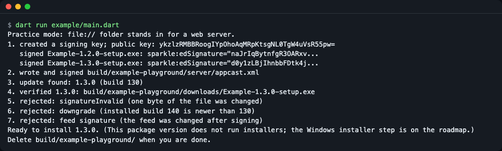
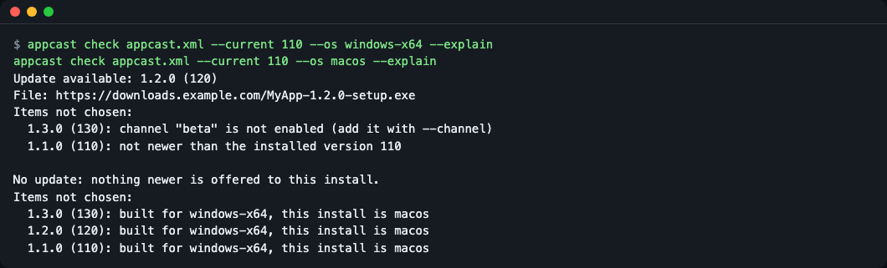
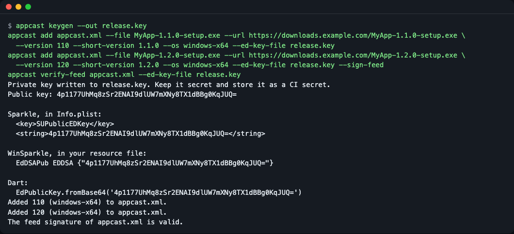
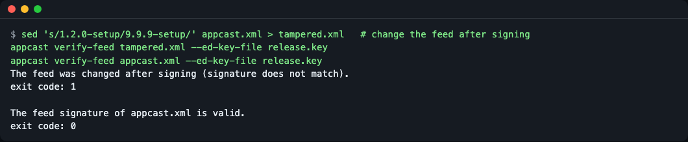
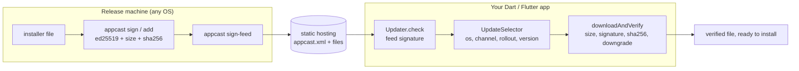

# appcast_updater

**English** | [한국어](README.ko.md)

## What it is

Sparkle-compatible appcast parsing, Ed25519 signing and update verification in pure Dart, plus an `appcast` command line that signs releases and edits feeds on Linux, Windows and macOS. It uses the same feed format and the same keys as [Sparkle](https://sparkle-project.org/), so a Flutter desktop app that already ships on macOS with Sparkle can check and verify Windows updates from the same feed. Version 0.1.0 covers checking, choosing and verifying an update. It does not install anything yet (see [Roadmap](#roadmap) and [Known limitations](#known-limitations)).



*`dart run example/main.dart` runs the whole chain offline: a real key, real signatures, and three attacks that are rejected.*

## Why

Sparkle's `sign_update` and `generate_appcast` tools are macOS binaries, so a release that is signed on Linux or Windows CI needs another route. And once an app has Sparkle feeds and keys, switching to a package with its own format means replacing both. This package keeps the appcast and the key, and moves the signing and the verification into Dart code that runs anywhere.

How it compares with other Dart and Flutter options (read from each project's page and issue tracker on 2026-11-12; these projects change, so check their pages before deciding):

| | Feed format | Same keys as Sparkle | Sign on a Linux CI runner | Update verification you call from Dart |
|---|---|---|---|---|
| [auto_updater](https://pub.dev/packages/auto_updater) 1.0.0 | Sparkle appcast (wraps Sparkle on macOS, WinSparkle on Windows) | Yes | `sign_update` is macOS only | No, done by the native library |
| [desktop_updater](https://pub.dev/packages/desktop_updater) 3.2.11 | Its own JSON manifest | No | Its own CLI | Its own chain |
| [upgrader](https://pub.dev/packages/upgrader) 13.8.0 | Reads an appcast for a store-listing prompt | n/a | n/a | No, it only reads the `edSignature` field |
| **appcast_updater** 0.1.0 | Sparkle appcast | Yes (checked, see [Compatibility](#compatibility)) | Yes, `appcast` CLI | Yes, `Updater` / `UpdateVerifier` |

Good fit: you ship (or plan to ship) a macOS app with Sparkle and want the same feed and key for Windows; you want to sign releases on a Linux or Windows runner; or you want update checks to be plain Dart code you can read and test.

Look elsewhere if you need a ready-made update dialog and installer handling today ([auto_updater](https://pub.dev/packages/auto_updater)), an all-in-one Flutter package with its own release CLI ([desktop_updater](https://pub.dev/packages/desktop_updater)), or only a nudge towards a store listing ([upgrader](https://pub.dev/packages/upgrader)).

## Install

You need the [Dart SDK](https://dart.dev/get-dart) 3.5 or newer (a Flutter SDK includes it) and `git`. The package is not on pub.dev yet, so use the git dependency. This README was checked with Dart 3.8.1.

Add the package under `dependencies:` in your app's `pubspec.yaml` (for a new, empty folder, [Quick start](#quick-start) shows a complete `pubspec.yaml`):

```yaml
# pubspec.yaml of your app
dependencies:
  appcast_updater:
    git: https://github.com/LeeGyeongPil/appcast-updater
```

```bash
dart pub get
```

For the `appcast` command line only:

```bash
dart pub global activate --source git https://github.com/LeeGyeongPil/appcast-updater
appcast --version
```

```text
appcast 0.1.0
```

If the shell says it cannot find the `appcast` command, the pub cache `bin` folder is not on your `PATH` yet (`activate` warns about this: `Pub installs executables into ..., which is not on your path`). Add `$HOME/.pub-cache/bin` to `PATH` (Windows: `%LOCALAPPDATA%\Pub\Cache\bin`) and open a new terminal, or call the tool as `dart pub global run appcast_updater:appcast` instead of `appcast`.

Runtime dependencies: `xml`, `cryptography`, `crypto` (all pure Dart, no native code).

## Quick start

Make a signed feed with two releases, then let a "1.1.0" install check it. You need the `appcast` command from [Install](#install). Start in a new, empty folder and run every step inside it (`MyApp-*.exe` are stand-ins for your real installers):

```bash
mkdir appcast-quickstart
cd appcast-quickstart
mkdir feed
head -c 4000 /dev/zero | tr '\0' 'a' > feed/MyApp-1.1.0-setup.exe
head -c 5000 /dev/zero | tr '\0' 'b' > feed/MyApp-1.2.0-setup.exe
appcast keygen --out release.key
```

```text
Private key written to release.key. Keep it secret and store it as a CI secret.
Public key: <base64 ed25519 public key>
...
```

(The public key differs on every run. The command also prints lines to paste into `Info.plist`, a WinSparkle resource file and Dart code. The output is in English unless your system language is Korean; see [Language](#language).)

```bash
appcast add feed/appcast.xml --file feed/MyApp-1.1.0-setup.exe --url file://$PWD/feed/MyApp-1.1.0-setup.exe \
  --version 110 --short-version 1.1.0 --os windows-x64 --ed-key-file release.key
appcast add feed/appcast.xml --file feed/MyApp-1.2.0-setup.exe --url file://$PWD/feed/MyApp-1.2.0-setup.exe \
  --version 120 --short-version 1.2.0 --os windows-x64 --ed-key-file release.key --sign-feed
```

```text
Added 110 (windows-x64) to feed/appcast.xml.
Added 120 (windows-x64) to feed/appcast.xml.
```

Now the app side. A Dart program finds `package:appcast_updater` through a `pubspec.yaml`, so create one in the same folder and fetch the dependencies (this step needs network access to GitHub and pub.dev):

```bash
cat > pubspec.yaml <<'EOF'
name: check_feed
publish_to: none

environment:
  sdk: ^3.5.0

dependencies:
  appcast_updater:
    git: https://github.com/LeeGyeongPil/appcast-updater
EOF
dart pub get
```

```text
Resolving dependencies...
...
Got dependencies!
```

The last line can also read `Changed N dependencies!` on the first run; both mean it worked.

Save this as `check.dart` in the same folder (the public key is passed as the first argument):

```dart
import 'dart:io';

import 'package:appcast_updater/appcast_updater.dart';

Future<void> main(List<String> args) async {
  final updater = Updater(
    feedUrl: Uri.file(File('feed/appcast.xml').absolute.path),
    publicKey: EdPublicKey.fromBase64(args.first),
    currentVersion: '110', // sparkle:version of the installed app
    os: 'windows-x64',
    requireSignedFeed: true,
  );

  final found = await updater.check();
  final item = found.item;
  if (item == null) {
    print('Up to date.');
    return;
  }
  print('Offered: ${item.shortVersion} (build ${item.version})');

  try {
    final file = await updater.downloadAndVerify(item,
        into: Directory('downloads'));
    print('Verified: ${file.path}');
  } on UpdateVerificationException catch (e) {
    print('Rejected: ${e.reason.name}');
  }
}
```

```bash
dart run check.dart "$(appcast pubkey --ed-key-file release.key)"
```

```text
Offered: 1.2.0 (build 120)
Verified: downloads/MyApp-1.2.0-setup.exe
```

Now change one byte of `feed/MyApp-1.2.0-setup.exe`, as an attacker or a broken download would, and run it again:

```bash
printf 'X' | dd of=feed/MyApp-1.2.0-setup.exe bs=1 count=1 conv=notrunc 2>/dev/null
dart run check.dart "$(appcast pubkey --ed-key-file release.key)"
```

```text
Offered: 1.2.0 (build 120)
Rejected: signatureInvalid
```

The size is still right, but the signature no longer matches. The changed copy is not saved: `downloads/` still holds only the file verified in the first run. In a real release the `--url` values are `https://` addresses of your own static hosting. `file://` is for practice.

## Release side: CLI

All commands accept `--lang en|ko` (see [Language](#language)). Exit codes: `0` success, `1` check failed or file problem, `2` wrong usage, `3` key problem.

| Command | What it does |
|---|---|
| `appcast keygen --out <file>` | Create an Ed25519 key (32-byte seed, base64, Sparkle 2 format). Never overwrites a file. |
| `appcast pubkey --ed-key-file <file\|->` | Print the public key (the `SUPublicEDKey` value). |
| `appcast sign <file> --ed-key-file <file\|-> [-p]` | Print `sparkle:edSignature="..." length="..."` (same text as Sparkle `sign_update`); `-p` prints only the signature. |
| `appcast verify <file> <signature> --public-key <b64> \| --ed-key-file <file\|->` | Exit 0 if the signature matches the file. |
| `appcast add <appcast.xml> --file ... --url ... --version ...` | Sign a release and add an item on top of the feed (creates the feed). Options include `--short-version`, `--os`, `--channel`, `--min-system`, `--max-system`, `--phased-interval`, `--critical`, `--critical-below`, `--notes-url`, `--installer-arguments`, `--pub-date`, `--replace`, `--sign-feed`. |
| `appcast sign-feed <appcast.xml> --ed-key-file <file\|->` | Append or replace the feed signature. |
| `appcast verify-feed <appcast.xml\|url> --public-key <b64> \| --ed-key-file <file\|->` | Exit 0 if the feed signature is valid. With `--ed-key-file` the public key is taken from the private key. |
| `appcast check <appcast.xml\|url> --current <v> --os <name> --explain` | Show which update an install would get, and why every other item was not chosen. |

Use `--ed-key-file -` to read the key from standard input, which suits CI secrets: `echo "$RELEASE_KEY" | appcast sign app.exe --ed-key-file -`.

`check --explain` answers "why does my app not see the update?":



*The 1.3.0 item is on the `beta` channel, so it is not chosen. For a macOS install nothing matches, because all items are for `windows-x64`.*

With `--explain` it also says what is wrong with an item it had to skip, so you know what to fix in the feed (without `--explain` only the first line is printed):

```text
No update: nothing newer is offered to this install.
Item #1 was skipped: it has no <enclosure> with a url attribute.
```

A release flow in one screen (a CI job would run exactly these lines):



*Two `add` calls build the feed; `--sign-feed` signs it; `verify-feed` confirms.*

If the feed is changed after signing, verification fails with exit code 1:



*The edited copy is rejected; the untouched feed still verifies.*

## App side: Dart API

Everything is exported from `package:appcast_updater/appcast_updater.dart`.

| Name | What it does | Main inputs | Returns / throws |
|---|---|---|---|
| `Updater` | Facade: check a feed, then download and verify. | `feedUrl`, `publicKey`, `currentVersion`, `os`, `channels`, `systemVersion`, `rolloutGroup`, `requireSignedFeed`, `fetcher` | `check()` returns `UpdateCheck` (`item`, `critical`, `selection`, `feedWasSigned`); `downloadAndVerify(item, into:)` returns the verified `File` |
| `UpdateSelector` | Choose the item for an install and record why others lost. | same filters as `Updater` | `select(appcast)` returns `Selection` (`item`, `critical`, `rejections`) |
| `RejectReason`, `Rejection` | Why an item was not chosen: `wrongOs`, `channelNotAllowed`, `systemTooOld`, `systemTooNew`, `informational`, `notNewer`, `rolloutNotYet`, `superseded`. | | |
| `RolloutGroup`, `RolloutGroupStore` | Pick one of 7 phased-rollout groups once and keep it in a file. | `File` | `loadOrCreate()` returns the group (0-6) |
| `UpdateVerifier` | Verify a downloaded file: size, signature, sha256, downgrade. | `publicKey`, `allowUnsigned` | `verifyFile(file, item, currentVersion:)`; throws `UpdateVerificationException` with `reason` (`VerifyFailure`) |
| `SignedFeed` | Sign, verify and strip the feed signature. | raw bytes, key | `sign`, `verify` (returns the body), `strip`, `hasSignature`; throws `FeedSignatureException` (`FeedFailure`) |
| `Appcast`, `AppcastItem`, `Enclosure`, `ItemError` | Parse a feed. Malformed items are reported in a list instead of failing the whole feed. | XML text or bytes | `Appcast.parse`, `Appcast.parseBytes`; throws `AppcastFormatException` |
| `AppcastWriter` | Create a feed or add an item (keeps your existing namespace prefixes). | | `createEmpty`, `parse`, `addItem`, `toXmlString`; throws `DuplicateItemException` |
| `EdKeyPair`, `EdPrivateKey`, `EdPublicKey` | Keys. Reads Sparkle key files, including legacy 96-byte ones (public key and verification only). | seed or key file text | throws `KeyFormatException` |
| `signBytes`, `signFile`, `verifyBytes`, `SparkleSignature` | Raw Ed25519 over bytes or a file; `toSparkleAttributes()` prints the `sign_update` line. | data, key | base64 signature / `SparkleSignature` / `bool` |
| `compareVersions` | Version comparison with the rules of Sparkle's `SUStandardVersionComparator`. | two strings | negative, `0` or positive `int` |
| `Fetcher`, `FileFetcher`, `HttpFetcher` | Fetch bytes and files with a size cap. `https://` and `file://` only; `http://` needs `allowInsecureHttp`. | `Uri`, `maxBytes` | throws `DownloadException` |

Turn on `requireSignedFeed: true` in your app. Without it, a feed that has no signature comment is accepted (a feed that has one is always verified).

**Example 1. Why does this install not see an update?** Use `UpdateSelector` directly and print the reasons:

```dart
final selection = UpdateSelector(
  currentVersion: '110',
  os: 'windows-x64',
).select(Appcast.parse(File('feed/appcast.xml').readAsStringSync()));
for (final r in selection.rejections) {
  print('${r.item.version}: ${r.reason.name}');
}
```

**Example 2. Sign a release file from Dart** (same text as Sparkle `sign_update`):

```dart
final keys = await EdKeyPair.generate();
final sig = await signFile(File('feed/MyApp-1.2.0-setup.exe'), keys.privateKey);
print(sig.toSparkleAttributes()); // sparkle:edSignature="..." length="5000"
```

**Example 3. Practice run.** [`example/main.dart`](example/main.dart) does everything offline in `build/example-playground/` and is safe to run repeatedly:

```bash
dart run example/main.dart
```

```text
5. rejected: signatureInvalid (one byte of the file was changed)
6. rejected: downgrade (installed build 140 is newer than 130)
7. rejected: feed signature (the feed was changed after signing)
```

This is a practice (mock) mode: the "download server" is a folder read through `file://`, and no installer is started. Keys, signatures, hashes and every rejection are real computations. The practice example prints English only.

## How verification works

Think of a parcel with a tamper-evident seal. Only you own the sealing machine (the private key), and every customer has a copy of the seal pattern (the public key). A parcel whose seal does not match is not opened.

- **appcast**: the update feed. An RSS file with one `<item>` per release; each `<enclosure>` carries the download URL, size and a signature. It is the format Sparkle uses.
- **EdDSA (Ed25519) signature**: a 64-byte signature over the exact bytes of the release file. Your app contains only the 32-byte public key (`SUPublicEDKey` in Sparkle). Whoever lacks the private key cannot make an update your app accepts.
- **Signed feed**: Sparkle 2.9+ can also sign the feed itself (`SURequireSignedFeed`). A comment `<!-- sparkle-signatures: ... -->` at the end holds a signature over the original bytes before it. Because the signature covers bytes, the check runs on the downloaded bytes before the feed is parsed or written out again; re-serializing the XML would change the bytes and break it. This stops someone from swapping the feed for another one. Every edit to the feed removes the signature, so sign again after the last change.
- **Downgrade blocking**: a correctly signed but older release is still rejected, so an attacker cannot hand out an old, vulnerable version.
- **Update signature is not code signing.** The EdDSA signature proves the file came from you. It does not replace Windows code signing or macOS code signing and notarization, which the operating system checks when the installer runs. You need both.



1. The release machine signs each installer and adds an item to the feed, then signs the feed.
2. The app downloads the feed and checks the feed signature first.
3. It picks the newest item that fits this install (see [Selection rules](#selection-rules)).
4. It downloads the file with a size cap and verifies it before anything else touches it.

Checks on a downloaded file run in this order: size (before reading the content), Ed25519 signature, `au:sha256`, downgrade. Other safety rules: `https://` only (plain `http://` needs `allowInsecureHttp`), redirects are checked hop by hop, the file keeps its final name only after it passes, and a feed served over `https://` cannot point the app at a local `file://` path.

## Selection rules

`UpdateSelector` (used by `Updater.check()` and `appcast check`) applies these rules to every item and records the reason for each item it does not choose. Rules follow Sparkle's [publishing documentation](https://sparkle-project.org/documentation/publishing/) (read 2026-11-12).

| Rule | Behavior |
|---|---|
| Operating system | An item with `sparkle:os` must match the install's `os` (an item tagged `windows` also matches an install of `windows-x64`). An item without `sparkle:os` matches every OS (WinSparkle behavior); set `untaggedMeans: 'macos'` to read it as macOS like Sparkle. |
| Channel | An item without `sparkle:channel` is always included. An item on a channel is chosen only if the install lists that channel. |
| System version | Checked only when `systemVersion` is given: below `minimumSystemVersion` or above `maximumSystemVersion` is rejected. |
| Newer only | The item's `sparkle:version` must be greater than `currentVersion`, compared with Sparkle's rules (`1.10` > `1.9`, `1.0beta` < `1.0`). Of the items that remain, the highest version wins. |
| Critical update | `criticalUpdate` with a `sparkle:version` value counts only for installs whose version is below that value; without a value it counts for everyone. Critical updates ignore phased rollout. |
| Phased rollout | Needs `phasedRolloutInterval` and `pubDate`, and a group set on the updater. Each install is in one of 7 groups (0 to 6) and sees the item from `pubDate + group x interval`. Critical updates and user-initiated checks (`userInitiated: true`) skip this wait. Keep the group with `RolloutGroupStore` so it stays the same for one install. |
| Informational | An item marked informational is parsed but never offered for download. |

## Compatibility

What was checked against the real Sparkle 2.10.1 (release archive, vectors in `test/vectors/`, steps in `test/vectors/README.md`, checked 2026-11-12):

- `appcast sign` prints the same `sparkle:edSignature="..." length="..."` text as Sparkle's `sign_update` for the same key and file (a string comparison in `test/sparkle_compat_test.dart`).
- Dart verifies a signature that `sign_update` made, and the Ed25519 implementation passes the [RFC 8032](https://www.rfc-editor.org/rfc/rfc8032) test vectors.
- A signed feed body that Sparkle's `sign_update --verify` accepts (exit 0) is also accepted by `SignedFeed.verify`. Feed signing needs Sparkle 2.9 or newer ("Add support for signing and verifying appcast feeds" in the [2.10.1 changelog](https://github.com/sparkle-project/Sparkle/blob/2.10.1/CHANGELOG), read 2026-11-12).
- One test-only gap: Sparkle's own feed-signing mode could not save its output inside the sandbox where the vectors were made, so the feed signature comment was added by hand in Sparkle's documented format and then verified by Sparkle (see `test/vectors/README.md`).

Limits to know:

- **`au:sha256` is only checked by this package.** It is an extra attribute (`urn:appcast-updater:1`) written by `appcast add`. Sparkle and WinSparkle ignore it, so on a Mac that updates through Sparkle only the EdDSA signature protects the file.
- **Legacy 96-byte private keys**: the public key can be read and signatures verified, but `sign`, `add` and `sign-feed` stop with exit code 3. Use Sparkle's own `sign_update` for them, or create a new 32-byte key (the public key in your app then changes).
- Dart is stricter than Sparkle about a broken feed signature: a malformed signature comment is an error here.

## Roadmap

Not in 0.1.0, so do not rely on it yet:

- **Windows install and relaunch** (Inno Setup, NSIS and MSI silent arguments, wait for the app to exit, detached installer, result check) and signing with legacy 96-byte private keys (they exit with code 3 today).
- **macOS Sparkle 2 notes and a release workflow** (`SUFeedURL`, `SUPublicEDKey`, `SURequireSignedFeed`, a Linux-runner release job).

Today the package ends at "a verified file on disk"; starting the installer is up to your app.

## Known limitations

- Signing and verifying read the whole file into memory (a 200 MB installer needs about 200 MB of memory while it is checked). The size is compared first, so a file of the wrong length is not read. Streaming is planned for a later version.
- Installing and relaunching are not part of 0.1.0; your app starts the installer.
- Real `https://` downloads are not covered by automated tests (the tests use `file://` and a local `127.0.0.1` server).
- The guard that rejects a `file://` enclosure in an `https://` feed has no regression test yet.
- Screenshots show commands first and outputs after; the `sign` and `--lang ko --help` outputs are given as text only.
- The package does no code signing or notarization. Do those with the platform tools in your release pipeline.

## Language

The command line speaks English and Korean. The order of precedence is `--lang en|ko`, then the `APPCAST_UPDATER_LANG` environment variable, then `LC_ALL`, `LC_MESSAGES`, `LANG` (Korean if the value starts with `ko`, otherwise English). The command output shown in this README is the English text; on a Korean system add `--lang en` to see the same lines.

```bash
APPCAST_UPDATER_LANG=ko appcast check feed/appcast.xml --current 110 --os windows-x64
```

## Troubleshooting

| Symptom | Cause | Fix |
|---|---|---|
| `Refusing to overwrite release.key...` (exit 1) | `keygen` never replaces a key | Pick another file name or delete the old key on purpose |
| `... is not a valid key file. Expected base64 of a 32-byte seed...` (exit 3) | The file is not a Sparkle EdDSA private key | Create one with `appcast keygen`, or export yours from Sparkle |
| `Version 120 for windows-x64 is already in appcast.xml. Use --replace...` (exit 1) | Same version and os already in the feed | Add `--replace` or use a new version |
| `The feed has no signature.` / `FeedSignatureException` | The feed lacks the `sparkle-signatures` comment (any edit removes it) | Run `appcast sign-feed` after the last change, or use `add --sign-feed` |
| `check` prints `built for windows-x64, this install is macos` | `--os` does not match the item's `sparkle:os` | Use the same os name in `--os` / `Updater(os: ...)` |
| `channel "beta" is not enabled` | The item is on a channel your install did not opt into | Add `--channel beta` / `Updater(channels: {'beta'})` |
| `rejected: downgrade` | The offered build is not newer than the installed one | Raise `sparkle:version` of the new release |
| `No update: nothing newer is offered...` although the feed has a newer item | An item in the feed is incomplete and was skipped | Run `appcast check ... --explain`: it prints `Item #1 was skipped: it has no <enclosure> with a url attribute.` (the message names what is missing). Fix that `<item>` |
| `... is not well-formed XML (an empty or cut-off file also looks like this).` (exit 1) | The file is empty, cut off or not XML | Re-upload or regenerate the feed |
| `Missing required option --os.` (exit 2) | Wrong usage | Run `appcast check --help` |

## Versioning

SemVer. While the version is 0.x, the API can change in a minor release; changes are listed in [CHANGELOG.md](CHANGELOG.md).

## Development

```bash
dart pub get
dart test
dart analyze
dart format --output=none --set-exit-if-changed .
```

The Sparkle compatibility vectors in `test/vectors/` come from Sparkle 2.10.1 (`test/vectors/README.md` explains how they were made). The seed used there is a test-only key (bytes 0 to 31) that protects nothing. The sources used for this README (accessed 2026-11-12): [Sparkle documentation](https://sparkle-project.org/documentation/), [publishing an update](https://sparkle-project.org/documentation/publishing/), [RFC 8032](https://www.rfc-editor.org/rfc/rfc8032), [Sparkle 2.10.1 changelog](https://github.com/sparkle-project/Sparkle/blob/2.10.1/CHANGELOG).

## License

MIT.
